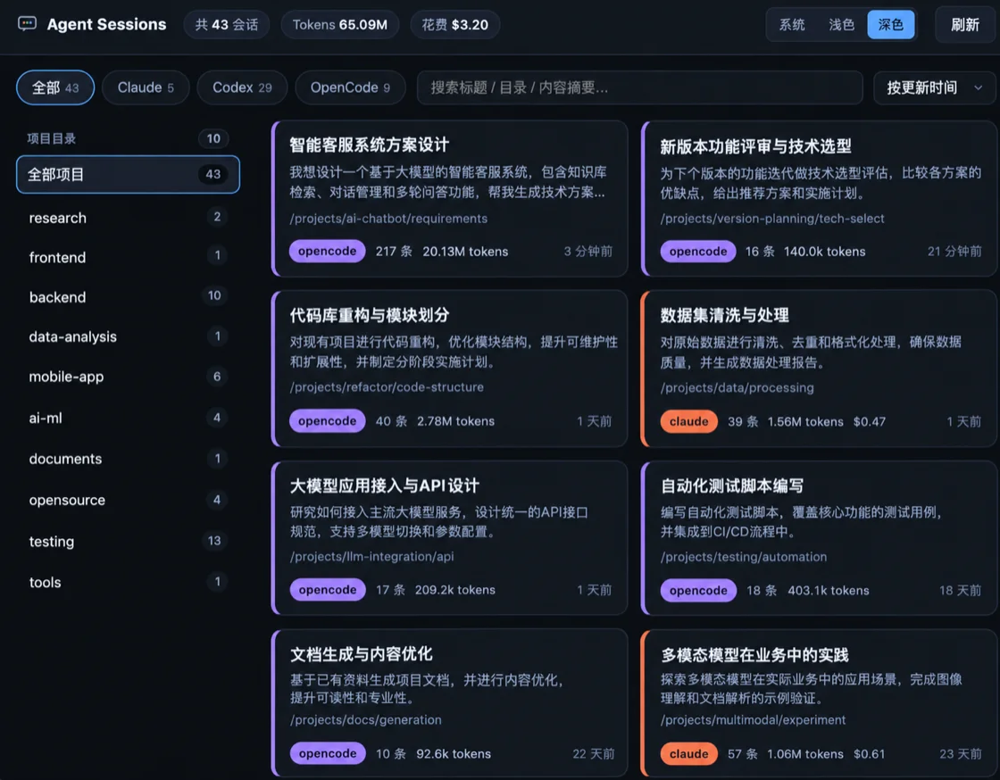

# Agent Session Viewer

一个轻量的本地工具，用于浏览本机上 **Claude Code**、**Codex** 和 **OpenCode** 的历史对话记录。

- 单个 Go 二进制，内嵌前端页面
- 增量索引：只扫描新增内容，二次启动几乎瞬时
- 空闲低占用，不主动轮询，启动时扫描或手动刷新



## 快速开始

```bash
go build -o asv .
./asv            # 默认：索引持久化到 SQLite 缓存
./asv -memory    # 可选：索引只放内存，不创建/读写缓存数据库
```

然后打开 http://localhost:8787 。

前端功能：

- 顶部标签切换：全部 / Claude / Codex / OpenCode，各标签带会话数量
- 主题切换：跟随系统 / 浅色 / 深色（记住选择，无刷新闪烁）
- 左侧项目目录侧边栏：按工作目录查看会话，标题显示目录总数，各目录显示会话数，点击筛选（窄屏自动切换为下拉框）
- 概览卡片：按 agent 配色的左侧色条、标题、首条用户消息摘要、消息数、Token、花费、更新时间
- 搜索（标题 / 目录 / 内容摘要，匹配项高亮）、排序（更新时间 / 创建时间 / 消息数 / Token）
- 点击卡片查看完整对话：展示标题、目录、模型、统计信息，可折叠「思考 / 工具」内容
- 「刷新」按钮触发一次增量扫描

## 数据来源

| Agent | 路径 | 说明 |
|---|---|---|
| Claude Code | `~/.claude/projects/<编码路径>/<sessionId>.jsonl` | 标题取 `custom-title` / `ai-title` / `last-prompt`，费用取 `cost-state`，思考取 `thinking` 块 |
| Codex | `~/.codex/sessions/YYYY/MM/DD/rollout-*.jsonl` | 标题优先取 `session_index.jsonl`，模型取 `turn_context`，Token 取累计 `token_count`，回退解析 `response_item` |
| OpenCode | `~/.local/share/opencode/opencode.db` | 只读打开，读取 `session_v2` 与 `session_message`（兼容旧的 `message`/`part`） |

## 命令行参数

```
-port int              HTTP 端口（默认 8787）
-db string             缓存数据库路径（默认 ~/.local/share/agent-session-viewer/index.db，-memory 时忽略）
-claude-dir string     Claude projects 目录
-codex-dir string      Codex sessions 目录
-codex-index string    Codex session_index.jsonl 路径
-opencode-db string    OpenCode 数据库路径
-watch-interval int    每隔 N 秒自动增量扫描（0 = 仅按需，默认）
-memory                索引只保存在内存中，不创建也不读写缓存数据库（每次启动全量扫描）
```

## 设计要点

- **增量索引**：缓存数据库（SQLite）为每个源文件记录 `size` / `mtime` / 解析偏移量。文件未变化时整文件跳过；有追加时只解析新增字节并累加统计。
- **按需加载正文**：列表只读缓存，对话内容在点击某个会话时才从源文件读取，不进常驻内存。
- **稳定 ID**：解析出的 session id 随游标一起持久化，保证增量扫描时不会因为读不到文件头而错配。
- **只读访问**：读取 OpenCode 数据库与磁盘文件均为只读，不影响正在运行的 agent。
- **内存模式**：`-memory` 用内存版 SQLite（`mode=memory&cache=shared`）承载同一套索引，不落盘、不需要 `-db` 目录；代价是没有持久化游标，每次启动都要全量扫描一次。

## 项目结构

```
main.go                 CLI 入口
internal/config         路径与参数解析
internal/model          归一化的 Session / Message / Stats
internal/source         数据源接口与增量 Delta 定义
internal/source/claude  Claude Code 解析
internal/source/codex   Codex 解析（跨 rollout 文件合并对话）
internal/source/opencode OpenCode SQLite 解析
internal/index          缓存数据库 + 增量扫描编排
internal/api            HTTP API
web                     内嵌前端（HTML/CSS/JS）
```

## API

| 方法 | 路径 | 说明 |
|---|---|---|
| GET | `/api/stats` | 各 agent 会话数 / 消息数 / Token / 花费汇总 |
| GET | `/api/projects?agent=` | 按工作目录聚合的会话数 / 消息数 / Token |
| GET | `/api/sessions?agent=&cwd=&q=&sort=&limit=` | 会话概览列表 |
| GET | `/api/sessions/{agent}/{id}` | 单个会话的完整对话 |
| POST | `/api/rescan` | 触发增量扫描 |
