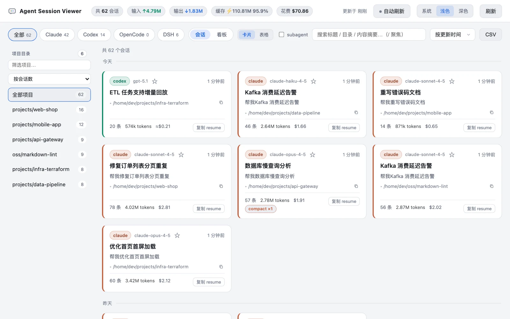
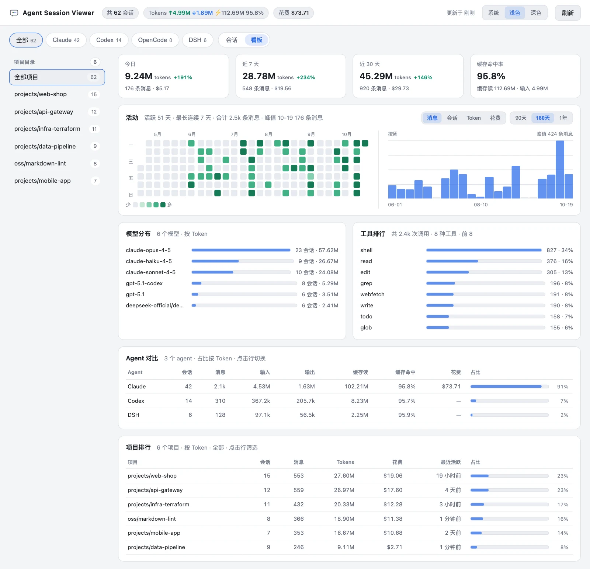
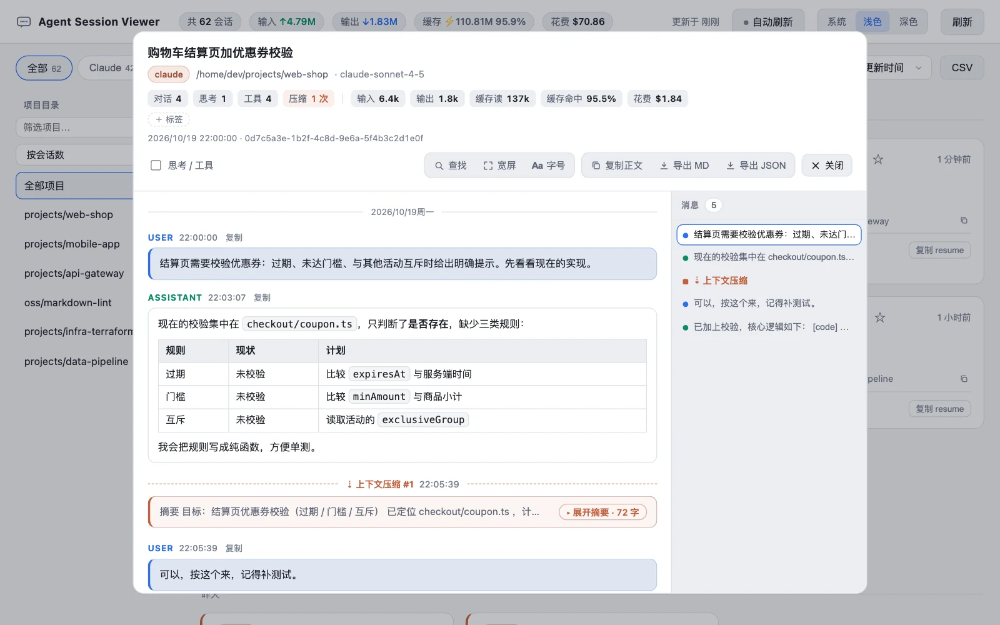

# Agent Session Viewer

一个轻量的本地工具，用于浏览本机上 **Claude Code**、**Codex**、**OpenCode** 和 **DeepSeek Harness（DSH）** 的历史对话记录。

- 单个 Go 二进制，内嵌前端页面
- 增量索引：只扫描新增内容，二次启动几乎瞬时
- 空闲低占用，可选主动轮询/手动刷新来更新信息

## 截图

**会话列表**：按 agent / 项目筛选，卡片显示模型、消息数、Token、花费与 compact 次数



**统计看板**：概览卡片、活动热力图与趋势、模型 / 工具排行、Agent 对比与项目排行



**对话详情**：Markdown 渲染、右侧消息大纲、上下文压缩标记与 Token 明细



<sub>截图使用合成的演示数据，可用 <code>node scripts/screenshots.mjs</code> 重新生成。</sub>

## 快速开始

需要 Go 1.26 或更高版本。

```bash
go build -o asv .
./asv            # 默认：索引持久化到 SQLite 缓存
./asv -memory    # 可选：索引只放内存，不创建/读写缓存数据库
```

打开 http://localhost:8787

## 数据来源

| Agent | 路径 |
|---|---|
| Claude Code | `~/.claude/projects/<编码路径>/<sessionId>.jsonl` |
| Codex | `~/.codex/sessions/YYYY/MM/DD/rollout-*.jsonl` |
| OpenCode | `~/.local/share/opencode/opencode.db`（只读打开） |
| DSH | `~/.dsh/sessions/<编码 cwd>/<sessionId>/session.vN.jsonl.zstd`（未压缩的 `session.vN.jsonl` 同样支持） |

会话标题、模型、Token、花费、工具调用与每日活动都从上述文件解析；子代理、分叉和续接关系也会自动识别并互相跳转。解析细节见 [设计说明](docs/DESIGN.md)。

四个 agent 的历史路径在各平台一致：Windows 上 `~` 即 `%USERPROFILE%`，OpenCode 也沿用 Unix 风格的 `~/.local/share/opencode`。DSH 默认读取 `~/.dsh/sessions`，设置了 `DSH_HOME` 时改为 `$DSH_HOME/sessions`。只有本工具自己的索引数据库遵循平台习惯——Windows 下默认 `%LOCALAPPDATA%\agent-session-viewer\index.db`，其他平台 `~/.local/share/agent-session-viewer/index.db`（`-db` 可覆盖）。

## 命令行参数

```
-host string           HTTP 绑定地址（默认 127.0.0.1；设为 0.0.0.0 才对外网开放）
-port int              HTTP 端口（默认 8787）
-db string             缓存数据库路径（默认 ~/.local/share/agent-session-viewer/index.db；Windows 下为 %LOCALAPPDATA%\agent-session-viewer\index.db；-memory 时忽略）
-claude-dir string     Claude projects 目录
-codex-dir string      Codex sessions 目录
-codex-index string    Codex session_index.jsonl 路径
-opencode-db string    OpenCode 数据库路径
-dsh-dir string        DSH sessions 目录（默认 ~/.dsh/sessions，遵循 DSH_HOME）
-watch-interval int    每隔 N 秒自动增量扫描（0 = 仅按需，默认）
-memory                索引只保存在内存中，不创建也不读写缓存数据库（每次启动全量扫描）
-version               打印版本号后退出
```

## API

| 方法 | 路径 | 说明 |
|---|---|---|
| GET | `/api/stats?agent=&cwd=&day=` | 会话数 / 消息数 / Token / 花费汇总；`agents` 为按目录统计的各 agent 分布（供标签页），`total` 随 agent + 目录 + 日期筛选 |
| GET | `/api/projects?agent=` | 按工作目录聚合的会话数 / 消息数 / Token / 花费 / 各 agent 分布，按会话数降序 |
| GET | `/api/sessions?agent=&cwd=&q=&day=&sort=&limit=` | 会话概览列表；`day` 只返回该本地日期有活动的会话 |
| GET | `/api/sessions/{agent}/{id}` | 单个会话的完整对话 |
| GET | `/api/activity?agent=&cwd=` | 按本地日期聚合的消息数与会话数（仅 API；看板热力图改用 `/api/trend`） |
| GET | `/api/trend?agent=&cwd=&days=` | 按本地日期的消息 / 会话 / Token / 花费趋势；Token 与花费按会话每日活跃度分摊 |
| GET | `/api/models?agent=&cwd=` | 按模型聚合的会话数 / 消息数 / Token / 花费 |
| GET | `/api/tools?agent=&cwd=&limit=` | 工具调用排行及未截断的总调用次数 |
| GET | `/api/relations?agent=&cwd=` | 处于父子关系中的会话（含父与子），供详情页显示并跳转到主会话 / subagent / 分叉 / 续接的关联会话 |
| POST | `/api/rescan` | 触发增量扫描 |

---

变更记录见 [CHANGELOG.md](CHANGELOG.md)，实现与解析细节见 [docs/DESIGN.md](docs/DESIGN.md)。
